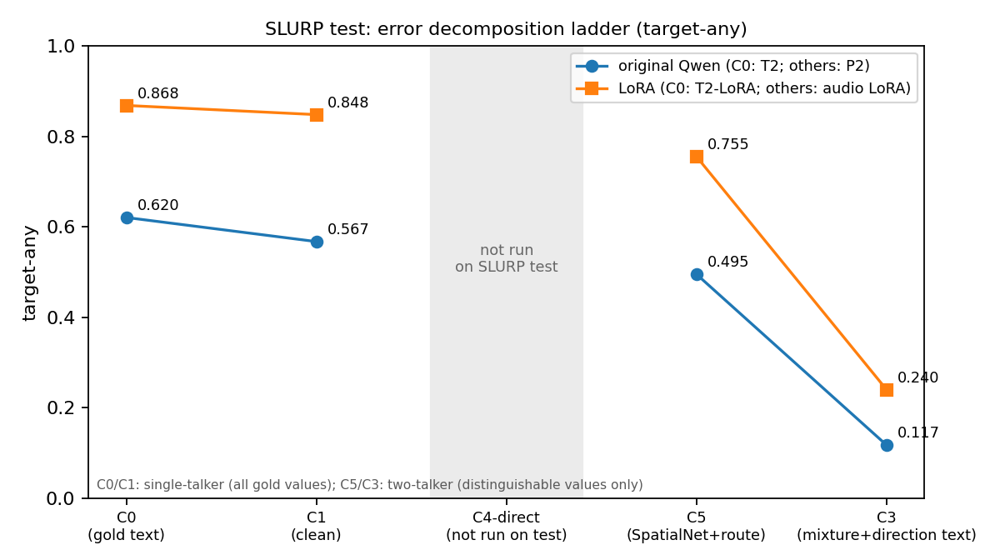
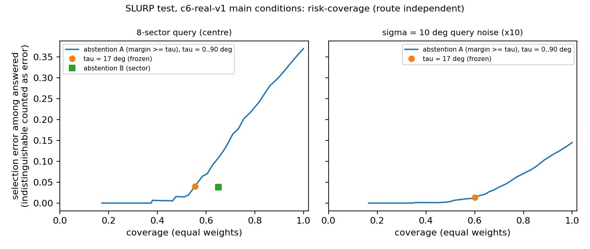
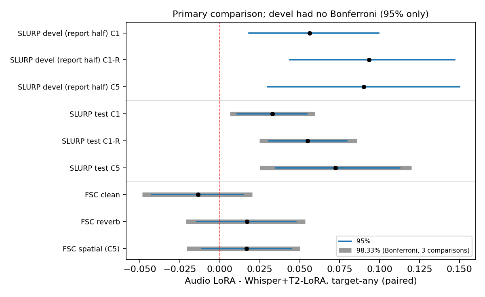

English translation of slurp_test_report_v1.md (translated 2026-11-16). The Chinese original is authoritative. 中文原文：slurp_test_report_v1.md

# Spatial-audio spoken language understanding: SLURP test results report v1 (paper draft)

> **Technical report v1, final version** (2026-11-13).

> 2026-11-12. Run **only once** on SLURP test under the frozen protocol `docs/slurp_test_freeze_v1.md` (approved 2026-11-11; the freeze commit is given in that document's run records). This report only collates existing results; nothing is recomputed and no result file is changed. The source file of every number is given in each section; sha256 values are in Appendix A.

## Abstract
- **SLURP test**: all three pre-specified primary comparisons (audio LoRA − Whisper + T2-LoRA, target-any) are significant under Bonferroni correction:
  - C1 +0.033, 98.33% [+0.006, +0.060];
  - C1-R +0.055 [+0.025, +0.086];
  - C5 +0.073 [+0.025, +0.120].
  - The magnitudes are smaller than on devel; the lower bound for C1 is close to 0; the naturally weighted version of C5 crosses 0.
- **Cross-dataset check (FSC, Section 7)**: **the primary comparison did not replicate on FSC.** All three 98.33% intervals cross 0; point estimates lie between −0.014 and +0.017.
- **Interferer risk**:
  - On SLURP, on the realistic system path, the interferer-only rate of both LoRAs is about +0.02 higher than their respective baselines;
  - On FSC, 92–98% of interferer hits on correctly routed samples come from default values filled in by the intent mapping (Section 7.4); the difference in interferer risk between the two LoRAs on FSC therefore **mainly reflects the mapping and cannot be interpreted as a difference in model behaviour**.
- All spatial conditions are simulated mixtures. The results of this report apply only to the data, simulated conditions and checkpoints tested; **no inference is made about performance on other datasets or in real environments**.

## 1. Research question

With two talkers speaking at the same time and only the target speaker's direction known, we compare two routes for passing speech to a large model for spoken language understanding (SLU: intent + entities). Both routes use exactly the same front-end separation and stream selection:

- **Audio route**: the separated target speech is fed directly into Qwen2.5-Omni, fine-tuned with an audio LoRA;
- **Cascaded route**: Whisper transcribes first, and Qwen2.5-Omni fine-tuned with a text LoRA (T2-LoRA) performs SLU.

**Primary question (pre-specified)**: on the same audio input, does the audio LoRA outperform Whisper + T2-LoRA? It is tested separately on three conditions: single-talker clean (C1), single-talker reverberant (C1-R), and two-talker mixture after spatial separation and stream selection (C5).

## 2. Setup

### 2.1 Data and splits
- **SLURP**, split_v2 (seed 2026, `configs/slurp_split_v2_seed2026.json`). Speakers, slurp_ids and sentence texts do not overlap across the three sets.
  - train: 3,513 recordings / 2,363 sentences;
  - devel: 428 recordings / 382 sentences (146 from official devel + 282 from train), used for checkpoint selection and debugging;
  - **test: 1,183 recordings / 812 sentences / 37 speakers**, used once, only after the final freeze.
- **C1**: test recordings as is, 16 kHz, no level adjustment.
- **C1-R**: single-talker full reverberation, using RIRs from SMS-WSJ **test_eval92** (mic 0): 16k → 8k → convolution → back to 16 kHz, level set to −30 dBFS. Each of the 1,183 recordings uses a distinct RIR sample.
- **Two-talker mixtures (mix_v1 rules)**:
  - test pairing: same gender, duration difference ≤ 1 s, the two talkers' entity-value sets differ distinguishably; each recording used at most 3 times; at most 30 groups per speaker; at least 20 male groups;
  - **200 groups** are drawn by 0/1 integer programming; swapping the target within each group gives two samples, **400 samples** in total;
  - SMS-WSJ test_eval92 RIRs (6 channels, 8 kHz), 50 groups in each of the four angle strata [0,15), [15,30), [30,60), [60,180]°;
  - SIR 0 dB (computed on the active frames of the mic 0 early image), white noise with SNR drawn from U(20, 30) dB;
  - the query direction is the target speaker's direction θ1.
  - Construction records: `configs/mix_v1_test_v1.json` and `configs/slurp_test_v1_s1_sha256.txt`.

### 2.2 Models
- **Base model**: Qwen2.5-Omni-7B (commit ae9e1690, bf16, talker disabled, greedy decoding). There are two frozen prompts: P2 (audio input) and T2 (text input).
- **ASR**: Whisper large-v3 (06f233fe, English, greedy decoding).
- **Audio LoRA**:
  - r16 / α32, applied to the 112 q/k/v/o modules of the thinker language model;
  - training data: the 3,513 clean train recordings plus 3,513 reverberant versions made with train_si284;
  - learning rate 1e-4, loss on the answer tokens only;
  - checkpoint selected on the devel C1 selection half: **step 440**.
- **Whisper + T2-LoRA**:
  - same structure as above;
  - training data: Whisper transcripts of the 7,026 training audio files above;
  - learning rate 1e-4; selected by the same rule: **step 660**.
- **Baselines**: original Qwen + P2 (audio), original Whisper + Qwen + T2 (cascaded).

### 2.3 Front end, stream selection and abstention
- **Front end**: SpatialNet-small, trained for 100 epochs on SMS-WSJ. The sha256 of the final checkpoint is `21caf0fc…6c10`; 6-channel 8 kHz input, two separated output streams.
  - cv_dev93 check on test: direct SI-SDRi 25.93 dB, PASS (`outputs/slurp_test_v1/frontend/cv_check.json`).
- **Stream selection (v3)**:
  1. polarity correction using the zero-lag mic 0 correlation;
  2. direction estimation for each stream (PHAT DOA);
  3. select the stream whose estimated direction is closest to the query direction; on a tie, take stream 0.
  - The selected stream goes through "polarity correction (applied once) → resampling to 16 kHz → −30 dBFS", and is then sent to both the audio route and the cascaded route. Both routes see exactly the same audio.
- **c6-real-v1** (simulating real use, where the user gives only a coarse direction):
  - 8 sectors: the query direction is the centre of the sector containing the target;
  - σ10: query direction = θ1 + N(0, 10°²), 10 repetitions.
  - **Abstention A**: abstain when the difference between the two streams' distances from the query direction (margin) is < 17°;
  - **Abstention B** (sector conditions only): abstain when the estimated directions of both streams fall inside the query sector;
  - samples whose direction is indistinguishable count as stream-selection errors and receive no target credit.

### 2.4 Metrics and statistics
- **Primary metric target-any** (binding-score-v1): at least one of the target's gold entity values is matched exactly.
  - Single-talker conditions: the interferer set is empty.
  - Mixture conditions: only values distinguishable between target and interferer are counted; target-only, interferer-only and pair flip are also reported.
- **Paired bootstrap**: B = 2000, `default_rng(2026)`.
  - Single-talker conditions: grouped resampling by slurp_id;
  - Mixture conditions: group-level resampling stratified by angle stratum; the two swapped samples of a group are drawn together.
- **Primary comparisons**: three, C1, C1-R and C5, with **Bonferroni correction**. Each reports a 98.33% interval (0.8333% / 99.1667% quantiles), **judged significant only if the lower bound is > 0**; the uncorrected 95% interval is also reported.
  - C5 is judged on the equal-weight (raw) basis; natural angle weighting is descriptive only.
- **Natural angle weighting**: the main results use the cv_dev93 angle distribution 78 / 96 / 155 / 653; the distribution of test_eval92 itself, 104 / 94 / 207 / 927, is also reported, descriptive only.
- After the test results came out, no checkpoint, threshold, prompt or route was adjusted. All jobs succeeded at the first attempt; nothing was rerun. GPU usage was 7.83 hours.

## 3. Main results: audio LoRA − Whisper + T2-LoRA

Source: `outputs/slurp_test_v1/score/report/report.json` → `primary`; the devel column comes from `outputs/lora_step2_eval/audio_vs_t2_comparison_v2/comparison.json` (C1 and C1-R report half) and `outputs/lora_step2_eval/audio_vs_t2_final_checks_corrected/checks.json` (C5 report half).

| Condition | test n | Audio LoRA | Whisper+T2-LoRA | **test difference** | test 95% | **test 98.33%** | devel report-half difference [95%] |
|---|---|---|---|---|---|---|---|
| C1 | 1,183 recordings / 812 sentences | 0.848 | 0.815 | **+0.033** | [+0.011, +0.055] | **[+0.006, +0.060]** | +0.056 [+0.018, +0.100] |
| C1-R | 1,183 / 812 | 0.806 | 0.751 | **+0.055** | [+0.031, +0.080] | **[+0.025, +0.086]** | +0.093 [+0.044, +0.147] |
| C5 (raw) | 400 samples / 200 groups | 0.755 | 0.683 | **+0.073** | [+0.035, +0.113] | **[+0.025, +0.120]** | +0.090 [+0.030, +0.150] |

- **All three are significant under Bonferroni correction** (98.33% lower bound > 0). The direction agrees with devel, but every magnitude is smaller than on the devel report half.
- **The 98.33% lower bound for C1 is only +0.006, close to 0.** Under clean single-talker conditions the gap between the two routes is small.
- **The naturally weighted version of C5** (cv_dev93) is +0.057, 95% [−0.009, +0.129], 98.33% [−0.023, +0.145]: it **crosses 0 and is descriptive only**.
- The devel intervals are uncorrected 95% intervals; no multiple-comparison correction was applied in the devel stage.

## 4. Improvement of both LoRAs over their own baselines; C0

Source: `report.json` → `single`, `other_comparisons`. The table below is target-any; paired differences [95%] in parentheses.

| Condition | Original P2 | Audio LoRA | Audio LoRA − P2 | Original Whisper+T2 | Whisper+T2-LoRA | T2-LoRA − Whisper+T2 |
|---|---|---|---|---|---|---|
| C1 | 0.567 | 0.848 | +0.281 [+0.240, +0.319] | 0.552 | 0.815 | +0.263 [+0.222, +0.302] |
| C1-R | 0.529 | 0.806 | +0.276 [+0.237, +0.313] | 0.499 | 0.751 | +0.252 [+0.214, +0.288] |
| C5 (raw) | 0.495 | 0.755 | +0.260 [+0.205, +0.313] | 0.425 | 0.683 | +0.258 [+0.203, +0.310] |

- **Other metrics (C1 / C1-R)**:

| Route | Strict intent accuracy | Entity F1 (strict) | Zero-entity outputs |
|---|---|---|---|
| Original P2 | 0.696 / 0.672 | 0.324 / 0.304 | 45 / 41 |
| Audio LoRA | 0.909 / 0.884 | 0.743 / 0.703 | 0 / 0 |
| Original Whisper+T2 | 0.668 / 0.624 | 0.324 / 0.302 | 41 / 66 |
| Whisper+T2-LoRA | 0.877 / 0.843 | 0.717 / 0.661 | 0 / 1 |

- Whisper WER: C1 0.074, C1-R 0.140, C5 selected stream (relative to the target sentence) 0.177.
- **C0 (reference transcripts, text upper-bound reference)**: original T2 target-any 0.621, T2-LoRA 0.868 (intent 0.708 → 0.904). Different recordings of the same sentence give identical outputs. The C1 result of T2-LoRA on Whisper transcripts (0.815) is 0.053 below the reference-transcript result; this is the cost of ASR errors. The audio LoRA (0.848) lies between the two.
- **Other C5 metrics**:

| Route | Pair flip (target-only in both swaps) | Interferer-only |
|---|---|---|
| Original P2 | 0.250 | 0.0025 |
| Audio LoRA | 0.555 | 0.015 |
| Original Whisper+T2 | 0.165 | 0.0025 |
| Whisper+T2-LoRA | 0.475 | 0.0175 |

**Figure 1**: error decomposition ladder on SLURP test (target-any), read by `scripts/figures/make_figures.py` from `outputs/slurp_test_v1/score/report/report.json`.
- Two lines: original Qwen (T2 for C0, P2 elsewhere) and LoRA (T2-LoRA for C0, audio LoRA elsewhere).
- **Different bases**: C0 and C1 use the single-talker basis (all gold values); C5 and C3 use the two-talker basis (distinguishable values only). Levels cannot be compared directly between the two segments.
- C4-direct was not run on test (not listed in the frozen protocol) and is left blank in the figure.

## 5. Direction uncertainty and abstention (c6-real-v1 main conditions)

Source: `outputs/slurp_test_v1/score/real_base/eval_c6_real.json`, `real_audio/eval_c6_real.json`, `checks_audio_vs_t2/checks.json`, summarised in `report.json` → `mix.c6_real_cv_dev93`.

- Stream selection (descriptive only, `outputs/slurp_test_v1/selection/eval_snapshot_mix.json`):
  - mean two-talker direct SI-SDRi on test 18.29 dB;
  - with query direction θ1, stream-selection accuracy is 0.980; 0.997 excluding the [0,15) angle stratum; 0.93 in the [0,15) stratum.
- The table below is target-any (natural weighting, cv_dev93); the last column is the equal-weight paired difference audio LoRA − T2-LoRA [95%]:

| Condition / abstention | Coverage | Original P2 | Original Whisper+T2 | Audio LoRA | Whisper+T2-LoRA | Audio − T2-LoRA |
|---|---|---|---|---|---|---|
| 8 sectors / no abstention | 1.000 | 0.450 | 0.384 | 0.696 | 0.650 | +0.040 [+0.008, +0.075] |
| 8 sectors / abstention A | 0.829 | 0.521 | 0.445 | 0.803 | 0.746 | +0.072 [+0.014, +0.131] |
| 8 sectors / abstention B | 0.872 | 0.516 | 0.441 | 0.798 | 0.745 | +0.062 [+0.011, +0.114] |
| σ10 / no abstention | 1.000 | 0.493 | 0.426 | 0.758 | 0.704 | +0.062 [+0.026, +0.098] |
| σ10 / abstention A | 0.855 | 0.520 | 0.451 | 0.804 | 0.750 | +0.065 [+0.011, +0.119] |

- At a cost of 13–17% coverage, abstention A and B raise target-any on answered samples by about 0.05–0.11, and interferer-only drops to about 0.01 (see Section 6).
- Weighting by the distribution of test_eval92 itself gives similar results (descriptive only; `report.json` → `mix.c6_real_test_eval92_descriptive`). For example, 8 sectors without abstention: audio LoRA 0.710, T2-LoRA 0.664.

**Figure 2**: risk–coverage for the c6-real-v1 main conditions on SLURP test, source `outputs/slurp_test_v1/score/real_base/risk_coverage.json`.
- Curves are abstention A (margin ≥ τ, τ = 0–90°); dots are the frozen τ = 17°; squares are abstention B (sector conditions only).
- Risk = stream-selection errors among answered samples (indistinguishable direction counts as an error); it does not depend on the route.
- **The x-axis is coverage on the equal-weight basis**, which differs from the naturally weighted coverage in the table above (e.g. 0.829).

## 6. Interferer risk and the limits of C3

The degradation thresholds of devel plan §6 (C3: interferer-only ≤ P2 + 0.02; c6-real main conditions ≤ P2 + 0.01) are **descriptive only on test** and are not used as gates.

### 6.1 C3: single-channel unseparated mixture + direction instruction
Source: `report.json` → `mix.C3` (scoring method as in devel §6).
- Interferer-only: original P2 **0.128 → audio LoRA 0.195** (+0.068); target-any 0.118 → 0.240.
- Total predicted entities: 437 → 487; interferer-value hits: 54 → 83.
- The conclusion is the same as on devel (devel: 0.115 → 0.220). **The audio LoRA does not pick out the target by direction from an unseparated mixture recording**; it extracts entities more aggressively, including the interferer's entities. C3 is not the actual path of this system (the actual path performs spatial separation first), but it shows that "selecting the talker through a direction instruction in the prompt" is not viable.

### 6.2 Realistic system path (c6-real main conditions, natural weighting)
Source: `outputs/slurp_test_v1/score/checks_p2/checks.json` (audio LoRA vs original P2), `checks_t2/checks.json` (T2-LoRA vs original Whisper+T2).

| Condition / abstention | Original P2 | Audio LoRA | Audio − P2 [95%] | Original Whisper+T2 | Whisper+T2-LoRA | T2-LoRA − Whisper+T2 [95%] |
|---|---|---|---|---|---|---|
| 8 sectors / no abstention | 0.0260 | 0.0500 | +0.0241 [+0.0106, +0.0421] | 0.0268 | 0.0486 | +0.0219 [+0.0081, +0.0395] |
| 8 sectors / abstention A | 0.0035 | 0.0139 | +0.0104 [0.0000, +0.0292] | 0.0035 | 0.0147 | +0.0111 [0.0000, +0.0292] |
| 8 sectors / abstention B | 0.0011 | 0.0117 | +0.0106 [−0.0011, +0.0291] | 0.0011 | 0.0106 | +0.0094 [−0.0022, +0.0266] |
| σ10 / no abstention | 0.0241 | 0.0479 | +0.0238 [+0.0127, +0.0403] | 0.0216 | 0.0449 | +0.0233 [+0.0122, +0.0388] |
| σ10 / abstention A | 0.0022 | 0.0111 | +0.0089 [+0.0006, +0.0250] | 0.0025 | 0.0122 | +0.0098 [−0.0001, +0.0263] |

**Split by actual routing correct / incorrect** (no abstention). Each cell is "target-value hits / interferer-value hits"; the number of observations is in parentheses:

| Condition | Routing | Original P2 | Audio LoRA | Original Whisper+T2 | Whisper+T2-LoRA |
|---|---|---|---|---|---|
| C5 | correct (392) | 202 / 0 | 327 / 3 | 175 / 0 | 295 / 3 |
| C5 | incorrect (8) | 0 / 1 | 0 / 3 | 0 / 1 | 0 / 4 |
| 8 sectors | correct (337) | 179 / 0 | 285 / 3 | 150 / 0 | 258 / 3 |
| 8 sectors | incorrect (63) | 0 / 26 | 0 / 44 | 0 / 27 | 0 / 42 |
| σ10 (× 10 runs) | correct (3,420) | 1,757 / 0 | 2,848 / 27 | 1,528 / 0 | 2,578 / 27 |
| σ10 (× 10 runs) | incorrect (580) | 0 / 270 | 0 / 464 | 0 / 239 | 0 / 425 |

**Interpretation**:
- Without abstention, the interferer-only rate of both LoRAs is about +0.022 to +0.024 higher than their respective baselines; **the two are similar**.
- The increase comes from the LoRAs extracting entities more aggressively: when routing is correct, interferer values are almost never hit (3 / 337, 27 / 3,420); **when the wrong stream is selected**, the LoRAs are more likely to extract the interferer's entities from that wrong stream. This is therefore a shared cost of "being better at extracting entities", **not specific to the audio route**; its root is stream-selection error.
- Abstention A or B reduces the increase to about +0.01 (+0.009 to +0.011). The upper bounds of the intervals are still about +0.025 to +0.029, so it cannot be regarded as statistically proven that the risk increase is below 0.01.
- Described against the devel thresholds: both no-abstention entries exceed +0.01; with abstention they are level with the threshold (σ10 abstention A +0.0089 is within the threshold; sector abstention A and B slightly exceed it).
- Pair-flip accuracy on C5 still improves (0.250 → 0.555).

## 7. Cross-dataset check (FSC): **the primary comparison did not replicate on FSC**

Plan `docs/fsc_extension_plan_v1.md` (freeze commit eaef16a: the mapping table `configs/fsc_mapping_v1.json` and the scoring code were frozen before inference on any new sample); results and run records `docs/fsc_extension_results_v1.md`; numbers from `outputs/fsc_ext_v1/score/report.json` (sha256 in Appendix A). FSC official test was not used.

### 7.1 Setup
- **Data**: FSC valid minus the 64 utterances already used by the pilot; 5 recordings drawn for each of the 248 sentence texts, 1,240 recordings in total (10 speakers), seed 2026.
- **Conditions**:
  - clean: original 16 kHz;
  - reverb: same chain as C1-R, test_eval92 RIRs;
  - spatial: 360 groups / 720 samples, mix_v1 rules, test_eval92 RIRs not repeated within a stratum, SpatialNet ep100 + v3 stream selection.
- **Models**: models, prompts and checkpoints are exactly the same as for SLURP test; nothing was trained or tuned on FSC.
- **Scoring**: the SLURP intents and entities output by the models are converted to FSC (action, object, location) by the frozen mapping. Primary metric target-any; statistics and Bonferroni correction as for SLURP test; for single-talker conditions the bootstrap is grouped by sentence text.
- **Data licence**: obtain FSC from the official Fluent.ai channel (official data page and licence in `configs/fsc_pilot_pending.json`); this project uses FSC for **noncommercial academic research only**, and the redistribution authorisation for the copy used **has not yet been confirmed by Fluent.ai**; it must be confirmed before publication.
- **Note on drafting the mapping table**: the author of the mapping table had seen part of the pilot's model outputs. The mapping rules are based on only two kinds of source: label definitions, and frequencies in the FSC train annotations (counts given for each rule). No model output was used as a basis.

### 7.2 Primary comparison: SLURP test and FSC side by side (audio LoRA − Whisper + T2-LoRA, target-any)
| Dataset / condition | n | Audio LoRA | Whisper+T2-LoRA | Difference | 95% interval | **98.33% interval** | Significant |
|---|---|---|---|---|---|---|---|
| SLURP C1 | 1,183 | 0.848 | 0.815 | +0.033 | [+0.011, +0.055] | [+0.006, +0.060] | Yes |
| **FSC clean** | 1,240 | 0.909 | 0.923 | **−0.014** | [−0.043, +0.015] | **[−0.049, +0.020]** | **No** |
| SLURP C1-R | 1,183 | 0.806 | 0.751 | +0.055 | [+0.031, +0.080] | [+0.025, +0.086] | Yes |
| **FSC reverb** | 1,240 | 0.877 | 0.861 | **+0.017** | [−0.015, +0.048] | **[−0.021, +0.054]** | **No** |
| SLURP C5 | 400 | 0.755 | 0.683 | +0.073 | [+0.035, +0.113] | [+0.025, +0.120] | Yes |
| **FSC spatial (C5)** | 720 | 0.815 | 0.799 | **+0.017** | [−0.011, +0.044] | **[−0.021, +0.050]** | **No** |

- The 95% intervals of all three FSC comparisons also cross 0.
- After removing the 25 sentences whose text is identical to SLURP train texts (descriptive only): clean −0.016, reverb +0.014; the conclusion is unchanged.
- The naturally weighted version of FSC spatial is −0.004 [−0.037, +0.029].

**Figure 3**: primary comparison (audio LoRA − Whisper + T2-LoRA, target-any, paired).
- Thin lines are 95% intervals; thick grey bars are 98.33% intervals (Bonferroni, 3 comparisons).
- **devel (report half) has only 95% intervals**: no multiple-comparison correction was applied in the devel stage, and the result files contain no 98.33% intervals.
- Sources: `outputs/lora_step2_eval/audio_vs_t2_comparison_v2/comparison.json`, `audio_vs_t2_final_checks_corrected/checks.json`, `outputs/slurp_test_v1/score/report/report.json`, `outputs/fsc_ext_v1/score/report.json`.

### 7.3 Possible reasons (**all unverified**)
1. **Under-estimation by the mapping**:
   - Both LoRAs score below the original baselines on the FSC action and object slots. For example, clean action accuracy: audio LoRA 0.665, T2-LoRA 0.693, original P2 0.781; proportion of object = none: audio LoRA 0.277, original P2 0.159.
   - One possibility is that the SLURP-style entities output by the LoRAs cannot be mapped to FSC values under the frozen rules. If so, the improvement of the LoRAs over the baselines is under-estimated.
   - Both LoRAs use the same mapping, but an asymmetric effect of the mapping on the two routes cannot be ruled out.
2. **FSC is closed-domain and the task is simple**: only 31 triples, 248 sentence texts and 10 speakers, with highly repetitive sentence patterns. Target-any for both routes is 0.86–0.92, possibly near the ceiling, which compresses the gap.
3. **A weaker front end**: stream-selection accuracy on FSC is 0.949 (SLURP 0.980), only 0.839 in the [0,15) stratum; separation SI-SDRi 16.5 dB (SLURP 18.3 dB).
- The improvement of both LoRAs over their own baselines is also much smaller on FSC: on clean, audio LoRA +0.061, T2-LoRA +0.098; on SLURP about +0.26 to +0.28.

### 7.4 Interferer risk: the difference on FSC mainly reflects the mapping
- **SLURP** (Section 6.2): on the realistic system path, the interferer-only rate of both LoRAs is about +0.02 higher than their respective baselines; the two are similar.
- **FSC** (c6-real main conditions, natural weighting, descriptive only):
  - T2-LoRA − original Whisper + T2: +0.044 [+0.017, +0.071] (8 sectors, no abstention);
  - audio LoRA − original P2: +0.003 [−0.021, +0.027];
  - audio LoRA − T2-LoRA is about −0.036 to −0.044 on C5 and under every main condition, with intervals excluding 0.
- On FSC, even with correct routing, there are about 0.05–0.07 interferer-value hits per observation (SLURP 0–0.009).
- **Interpretation**:
  - Post-hoc exploratory checks (`docs/fsc_extension_results_v1.md` Sections 6.3 and 6.4, no verdicts) found that **92–98% of interferer hits under correct routing come from default values filled in by the intent mapping** (intent-default object and intent → action); only 1–4 come from entity values output by the model;
  - the additional hits of T2-LoRA over the audio LoRA come mainly from intent-default objects (27 vs 12);
  - these hits show no consistent monotonic relationship with the degree of overlap between the two talkers' triples or with separation SI-SDRi (same file, Sections 6.1 and 6.4).
- **Therefore, the difference in interferer risk between the two LoRAs on FSC mainly reflects the mapping and cannot be interpreted as a difference in model behaviour.** The FSC values listed above are descriptive only.

## 8. What was not done and conclusions that cannot be drawn

- **Unseen real rooms and real recordings**: all spatial conditions were synthesised by convolving close-talk speech with SMS-WSJ simulated RIRs (image method) and adding white noise. The test_eval92 RIRs and the RIRs used for training (train_si284) come from the same simulator and the same kind of array configuration, only different room samples. Nothing was tested on real room recordings, real arrays, real noise or real reverberation; **performance in real environments cannot be inferred**.
- **Number of talkers and levels**: only two talkers, SIR 0 dB, SNR 20–30 dB were tested. More talkers, unequal levels and non-speech interference were not tested.
- **Query direction**: C5 uses the true target direction θ1 (oracle); c6-real replaces real user input with simulated sectors and Gaussian errors. **There is no real user direction input.**
- **Scope of methods**:
  - only "hard selection of one stream → single-stream SLU" (M1 type) was done;
  - **M3 (passing both separated streams, direction-match scores and reliability information to the LLM for fusion) is not implemented**; it is paused in the plan;
  - reliability-based stream selection (M2) is also not implemented;
  - this report cannot draw any conclusion about these methods.
- **C3 fails**: the audio LoRA cannot replace the spatial front end for selecting the talker (Section 6.1).
- **Single training run**: each LoRA was trained with one seed only and only one checkpoint is used (selected on the devel selection half). The variance due to training randomness was not estimated; the intervals of the test differences reflect sampling error only.
- **Magnitude of the primary comparison**: the gap on C1 is small (98.33% lower bound +0.006); the naturally weighted version of C5 crosses 0. It cannot be said that the audio route is better under every weighting, nor that the test effect size is as large as on devel.
- **Only one ASR**: Whisper large-v3, zero-shot, not fine-tuned. A stronger or domain-fine-tuned ASR might narrow the gap; this study did not test that.
- **Front end**: SpatialNet-small, 8 kHz. Other front ends were not compared on test, and joint training of the front end and the LLM was not tested.
- **Not run on test**: C4-direct, C6δ, the 4-sector and rotated splits, and sensitivity analyses such as σ = 5° / 15° (these were done only on devel); the frozen protocol did not require reporting them.
- **Cross-dataset**: the check was done only on FSC (a valid subset) (Section 7), and the primary comparison did not replicate; FSC official test was not used. Only two datasets were tested; conclusions about other datasets **cannot** be drawn from them.
- **FSC licence**: obtain FSC from the official Fluent.ai channel (official data page and licence in `configs/fsc_pilot_pending.json`); this project uses FSC for **noncommercial academic research only**, and the redistribution authorisation for the copy used **has not yet been confirmed by Fluent.ai**; it must be confirmed before publication.
- **Other**: only English was tested; only one base model (Qwen2.5-Omni-7B) was used; there was no human evaluation.

### 8.1 Options for future work (listed only; not carried out and not approved)
1. **Multiple training runs of both LoRAs**: retrain each LoRA with 3–5 random seeds to estimate the effect of training randomness on the primary comparison. Currently each has only one seed and one checkpoint.
2. **A second ASR**: e.g. an ASR from another family or a domain-fine-tuned one, to check whether the conclusion for the cascaded route depends on Whisper large-v3.
3. **Real recordings**: record two-talker overlapping speech in real rooms with real arrays (with real noise and reverberation), to test performance beyond simulated RIRs.
- In addition: neither M3 (LLM-level fusion) nor M2 (reliability-based stream selection) has been implemented yet (see above).

## 9. Reproduction entry points
- Frozen protocol and all run records (job IDs, commits, run times, sha256): `docs/slurp_test_freeze_v1.md`.
- Code freeze point: S0 b8b41d7; afterwards only data and records were committed; the scoring and construction code was not changed.
- Scoring: `scripts/lora/score_slurp_test_v1.py --inputs outputs/slurp_test_v1/score/inputs.json`.

## Appendix A: sha256 of source files

| File | sha256 |
|---|---|
| `outputs/slurp_test_v1/score/report/report.json` | `e457aa3cbdd16a6ec68bfc9204671cda811d2b488ce983c540e074a4d994db8f` |
| `outputs/slurp_test_v1/score/inputs.json` | `6a111e352123293c5ed93d6b0a2cc26e7d8e14856cc715216f13ba5633b19b7a` |
| `outputs/slurp_test_v1/score/checks_audio_vs_t2/checks.json` | `cc03a4f0b948988b42671e19ba67e718596a34570bfc055ad60d0e0f7be1047d` |
| `outputs/slurp_test_v1/score/checks_audio_vs_t2_te92/checks.json` | `27b6ff8a28e837a6dc8530e8da88d6ae1ea32f0e22889be2da494fec889fe887` |
| `outputs/slurp_test_v1/score/checks_p2/checks.json` | `f70e47a5a1bf647e5fd1206520bd1e0cbbb302b365a79a103e447b66dcd1af5e` |
| `outputs/slurp_test_v1/score/checks_t2/checks.json` | `ad23ae4fd2af1954af10f5ffb4758d1a055289a9f8b764147ed719d658aa2fd0` |
| `outputs/slurp_test_v1/score/c5_base/eval.json` | `8c64b14d8e3b07ab8afbb39708d35490046844b95844aeb1999536208a8ae921` |
| `outputs/slurp_test_v1/score/c5_audio/eval.json` | `5bf1078a3b3f42180415b83dd36ce4058c35abed3a650990f461bb5474ca1a7e` |
| `outputs/slurp_test_v1/score/real_base/eval_c6_real.json` | `14d708f8ec16b26525f2e14f75f8a17eabb501e4a3d25843159fbf694f0d26a7` |
| `outputs/slurp_test_v1/score/real_audio/eval_c6_real.json` | `f2ed8956cf518a734831bd27d7bc618ce76cd3165c18bd24e7c0221e8144c4f2` |
| `outputs/slurp_test_v1/score/real_base_te92/eval_c6_real.json` | `e1b8d4ce42de0c575df86c00ff4e26fc1cc09e9c3cf5dcc69c0282d6ed203bda` |
| `outputs/slurp_test_v1/selection/eval_snapshot_mix.json` | `a2a9a85d2617a56f341b0a215a3759a1f4292ae8b40e58a9fd4937fece0ab857` |
| `outputs/slurp_test_v1/frontend/cv_check.json` | `6d0aa99c0bcc5d0a987afddb46a75d91121e189f62d9be69c88b6cd592e8e1ae` |
| `configs/mix_v1_test_v1.json` | `26c0fb57e79fa4442526c824cd1d2c79e558af727dc1c11f41e4dea26b02695f` |
| `configs/slurp_test_v1_s1_sha256.txt` (sha256 of all test input files) | `d6475d2e27fc77cd466176759d9baba57a4db6ef4eca868bc09e0395241cd972` |
| `configs/slurp_split_v2_seed2026.json` | `eed16990a8f284c59393a7fed6fba2ec46b5dd2c3c215d1cb08e2f217a091d8c` |
| devel: `outputs/lora_step2_eval/audio_vs_t2_comparison_v2/comparison.json` | `e9821b98cd1b6e566df45b2f3ea4250653f2b34ac9d213234693dab6b8b7389c` |
| devel: `outputs/lora_step2_eval/audio_vs_t2_final_checks_corrected/checks.json` | `25e15e474c5f0590326d29daba2c1fcc309f023e75b61e813e8402e3b52c17fd` |
| FSC: `outputs/fsc_ext_v1/score/report.json` | `dc694398b0ff00f22b4e7eccc6aa655b4e1c63da65fe089e21521299193218e5` |
| FSC: `configs/fsc_mapping_v1.json` (frozen mapping) | `7a385e29c67bf9ac57ac034aa4149583b0d5432179cea71e9e1363d48f2f0ced` |
| FSC: `configs/fsc_ext_v1_list.json` | `ea4accd00a982e8c704bcff03c9de1c79dd9600a67d53c327d94868abcc63678` |
| FSC exploratory strata: `outputs/fsc_ext_v1/explore_overlap/overlap_strata.json` | `9ff2225790604b266b2f5fd520235eeff83108f6e66e5adb98df1611a1921ffd` |
| SpatialNet ep100 `best.pt` | `21caf0fc3b08cfc3b9860efbfeff9a756acecbe36101620378e47891edd76c10` |
