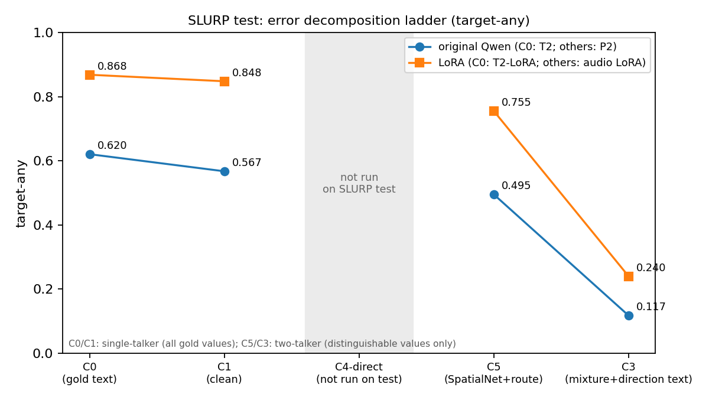
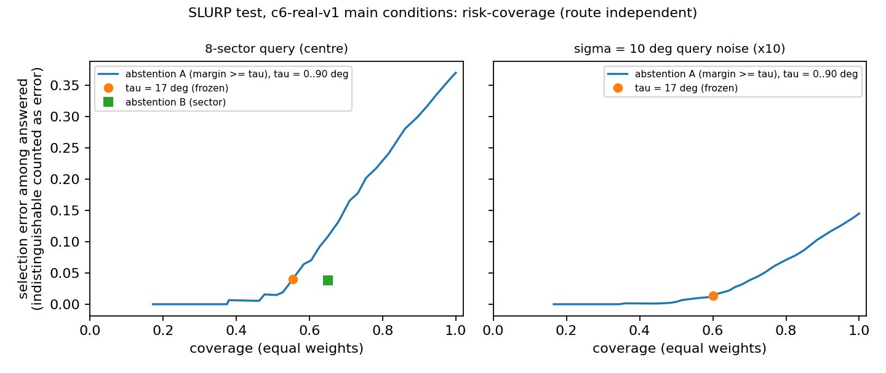
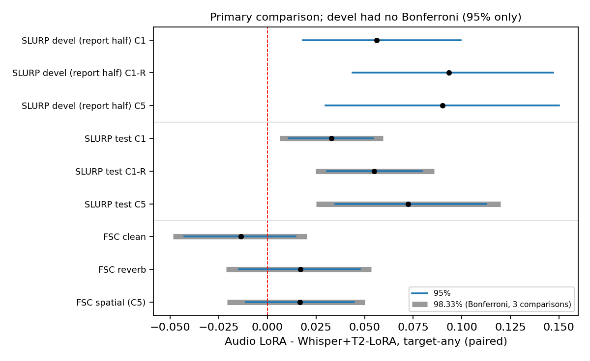

# 空间音频口语理解：SLURP test 结果报告 v1（论文底稿）

> **技术报告 v1 定稿**（2026-11-13）。

> 2026-11-12。按冻结协议 `docs/slurp_test_freeze_v1.md`（审批 2026-11-11，冻结 commit 见该文档运行记录）在 SLURP test 上**只运行一次**。本报告只整理已有结果，不重算、不改任何结果文件。所有数字的来源文件见各节，sha256 见附录 A。

## 摘要
- **SLURP test**：预先写定的三项主要比较（音频 LoRA − Whisper + T2-LoRA，target-any）在 Bonferroni 校正下都显著：
  - C1 +0.033，98.33% [+0.006, +0.060]；
  - C1-R +0.055 [+0.025, +0.086]；
  - C5 +0.073 [+0.025, +0.120]。
  - 幅度小于 devel；C1 的下界接近 0；C5 的自然加权版本跨 0。
- **跨数据集检验（FSC，第 7 节）**：**主要比较在 FSC 上未重现**。三项的 98.33% 区间都跨 0，点估计在 −0.014 至 +0.017 之间。
- **干扰者风险**：
  - SLURP 上，两种 LoRA 在真实系统路径上的"只命中干扰者"都比各自基线高约 +0.02；
  - FSC 上，路由正确时的干扰者命中有 92–98% 来自意图映射补出的默认值（第 7.4 节），因此 FSC 上两种 LoRA 的干扰者风险差异**主要反映映射方式，不能解释为模型行为差异**。
- 所有空间条件均为模拟混合。本报告的结果只针对所测的数据、模拟条件和 checkpoint，**不据此推断其他数据集或真实环境下的表现**。

## 1. 研究问题

在两人重叠说话、只知道目标说话人方向的条件下，比较两种把语音交给大模型做口语理解（SLU：意图 + 实体）的路线。两条路线用的前端分离和选路完全相同：

- **音频路线**：分离出的目标语音直接输入 Qwen2.5-Omni，用音频 LoRA 微调；
- **级联路线**：Whisper 先转写，再由文本 LoRA（T2-LoRA）微调的 Qwen2.5-Omni 做 SLU。

**主要问题（预先写定）**：在相同音频输入上，音频 LoRA 是否优于 Whisper + T2-LoRA。在三个条件上分别检验：单人干净（C1）、单人混响（C1-R）、两人混合经空间分离与选路后（C5）。

## 2. 设置

### 2.1 数据与划分
- **SLURP**，split_v2（seed 2026，`configs/slurp_split_v2_seed2026.json`）。三个集合之间的说话人、slurp_id 和句子文本互不重叠。
  - train：3,513 条录音 / 2,363 句；
  - devel：428 条 / 382 句（官方 devel 146 条 + train 282 条），用于选 checkpoint 和调试；
  - **test：1,183 条录音 / 812 句 / 37 位说话人**，只在最终冻结后使用一次。
- **C1**：test 录音原样，16 kHz，不调电平。
- **C1-R**：单人完整混响，用 SMS-WSJ **test_eval92** 的 RIR（mic 0）：16k → 8k → 卷积 → 回到 16 kHz，电平调到 −30 dBFS。1,183 条录音各用一个互不重复的 RIR 样例。
- **两人混合（mix_v1 规则）**：
  - test 的配对：同性别、时长差 ≤ 1 s、两人实体值集合有可区分的差异；每条录音最多用 3 次；单个说话人最多 30 组；男声至少 20 组；
  - 用 0/1 整数规划抽出 **200 组**，每组交换目标后得到两个样本，共 **400 个样本**；
  - SMS-WSJ test_eval92 RIR（6 通道，8 kHz），四个夹角层 [0,15)、[15,30)、[30,60)、[60,180]° 各 50 组；
  - SIR 0 dB（按 mic 0 早期像的有效帧计），SNR 服从 U(20, 30) dB 的白噪声；
  - 询问方向为目标说话人的方向 θ1。
  - 构造记录见 `configs/mix_v1_test_v1.json` 与 `configs/slurp_test_v1_s1_sha256.txt`。

### 2.2 模型
- **基础模型**：Qwen2.5-Omni-7B（commit ae9e1690，bf16，关闭 talker，贪心解码）。冻结的 prompt 有两个：P2（音频输入）和 T2（文本输入）。
- **ASR**：Whisper large-v3（06f233fe，英语，贪心解码）。
- **音频 LoRA**：
  - r16 / α32，作用在 thinker 语言模型的 112 个 q/k/v/o 模块；
  - 训练数据为 train 的 3,513 条干净录音加 3,513 条 train_si284 混响版本；
  - 学习率 1e-4，只对回答部分计损失；
  - 在 devel C1 选择半上选 checkpoint，选中 **step 440**。
- **Whisper + T2-LoRA**：
  - 结构同上；
  - 训练数据为上述 7,026 条训练音频的 Whisper 转写；
  - 学习率 1e-4，按相同规则选中 **step 660**。
- **基线**：原始 Qwen + P2（音频），原始 Whisper + Qwen + T2（级联）。

### 2.3 前端、选路与拒答
- **前端**：SpatialNet-small，在 SMS-WSJ 上训练 100 epoch。最终 checkpoint 的 sha256 为 `21caf0fc…6c10`；6 通道 8 kHz 输入，分离出两路输出。
  - test 上的 cv_dev93 核查：direct SI-SDRi 25.93 dB，PASS（`outputs/slurp_test_v1/frontend/cv_check.json`）。
- **选路（v3）**：
  1. 用零时延 mic 0 相关做极性修正；
  2. 对每一路估计方向（PHAT DOA）；
  3. 选估计方向离询问方向最近的一路，一样近时取第 0 路。
  - 选中的一路依次经过"极性修正（乘一次）→ 重采样到 16 kHz → −30 dBFS"，再分别送入音频路线和级联路线。两条路线看到的音频完全相同。
- **c6-real-v1**（用户只给出粗方向时，模拟真实使用）：
  - 8 扇区：询问方向取目标所在扇区的中心；
  - σ10：询问方向 = θ1 + N(0, 10°²)，10 次重复。
  - **拒答 A**：两路估计方向到询问方向的距离之差（margin）< 17° 时拒答；
  - **拒答 B**（仅扇区条件）：两路估计方向都落在询问扇区内时拒答；
  - 方向不可辨的样本计为选路错误，不给目标分。

### 2.4 指标与统计
- **主指标 target-any**（binding-score-v1）：目标的金标实体值中，至少有一个被精确命中。
  - 单人条件：干扰者集合为空。
  - 混合条件：只看目标与干扰者之间可区分的值；另报"只命中目标""只命中干扰者""配对翻转"。
- **配对 bootstrap**：B = 2000，`default_rng(2026)`。
  - 单人条件：按 slurp_id 成组重抽样；
  - 混合条件：组级重抽样、按夹角层分层，同组两个交换样本一起抽。
- **主要比较**：C1、C1-R、C5 三项，**Bonferroni 校正**。每项报告 98.33% 区间（0.8333% / 99.1667% 分位数），**下界 > 0 才判为显著**；另报未校正的 95% 区间。
  - C5 按等量（raw）口径判读；自然夹角加权只作描述。
- **自然夹角加权**：主结果用 cv_dev93 的夹角分布 78 / 96 / 155 / 653；另报 test_eval92 自身的分布 104 / 94 / 207 / 927，只作描述。
- test 结果出来后，没有调整任何 checkpoint、阈值、prompt 或路线。所有作业一次成功，没有重跑。GPU 用量 7.83 小时。

## 3. 主要结果：音频 LoRA − Whisper + T2-LoRA

来源：`outputs/slurp_test_v1/score/report/report.json` → `primary`；devel 一列来自 `outputs/lora_step2_eval/audio_vs_t2_comparison_v2/comparison.json`（C1、C1-R 报告半）和 `outputs/lora_step2_eval/audio_vs_t2_final_checks_corrected/checks.json`（C5 报告半）。

| 条件 | test n | 音频 LoRA | Whisper+T2-LoRA | **test 差值** | test 95% | **test 98.33%** | devel 报告半差值 [95%] |
|---|---|---|---|---|---|---|---|
| C1 | 1,183 条 / 812 句 | 0.848 | 0.815 | **+0.033** | [+0.011, +0.055] | **[+0.006, +0.060]** | +0.056 [+0.018, +0.100] |
| C1-R | 1,183 / 812 | 0.806 | 0.751 | **+0.055** | [+0.031, +0.080] | **[+0.025, +0.086]** | +0.093 [+0.044, +0.147] |
| C5（raw） | 400 个样本 / 200 组 | 0.755 | 0.683 | **+0.073** | [+0.035, +0.113] | **[+0.025, +0.120]** | +0.090 [+0.030, +0.150] |

- **三项在 Bonferroni 校正下都显著**（98.33% 下界 > 0）。方向与 devel 一致，但幅度都比 devel 报告半小。
- **C1 的 98.33% 下界只有 +0.006，接近 0。** 干净单人条件下，两条路线的差距很小。
- **C5 的自然加权版本**（cv_dev93）+0.057，95% [−0.009, +0.129]，98.33% [−0.023, +0.145]，**跨 0，只作描述**。
- devel 的区间是未校正的 95% 区间；devel 阶段没有做多重比较校正。

## 4. 两种 LoRA 相对各自基线的提升；C0

来源：`report.json` → `single`、`other_comparisons`。下表为 target-any；括号中为配对差 [95%]。

| 条件 | 原始 P2 | 音频 LoRA | 音频 LoRA − P2 | 原始 Whisper+T2 | Whisper+T2-LoRA | T2-LoRA − Whisper+T2 |
|---|---|---|---|---|---|---|
| C1 | 0.567 | 0.848 | +0.281 [+0.240, +0.319] | 0.552 | 0.815 | +0.263 [+0.222, +0.302] |
| C1-R | 0.529 | 0.806 | +0.276 [+0.237, +0.313] | 0.499 | 0.751 | +0.252 [+0.214, +0.288] |
| C5（raw） | 0.495 | 0.755 | +0.260 [+0.205, +0.313] | 0.425 | 0.683 | +0.258 [+0.203, +0.310] |

- **其他指标（C1 / C1-R）**：

| 路线 | 意图严格准确率 | 实体 F1（严格） | 零实体输出 |
|---|---|---|---|
| 原始 P2 | 0.696 / 0.672 | 0.324 / 0.304 | 45 / 41 |
| 音频 LoRA | 0.909 / 0.884 | 0.743 / 0.703 | 0 / 0 |
| 原始 Whisper+T2 | 0.668 / 0.624 | 0.324 / 0.302 | 41 / 66 |
| Whisper+T2-LoRA | 0.877 / 0.843 | 0.717 / 0.661 | 0 / 1 |

- Whisper WER：C1 0.074，C1-R 0.140，C5 选中路（相对目标句）0.177。
- **C0（标准转写，文本上限参照）**：原始 T2 target-any 0.621，T2-LoRA 0.868（意图 0.708 → 0.904）。同一句子的不同录音输出完全相同。T2-LoRA 在 Whisper 转写上的 C1 结果（0.815）比标准转写低 0.053，这是 ASR 误差的代价；音频 LoRA（0.848）介于两者之间。
- **C5 的其他指标**：

| 路线 | 配对翻转（两次交换都只命中目标） | 只命中干扰者 |
|---|---|---|
| 原始 P2 | 0.250 | 0.0025 |
| 音频 LoRA | 0.555 | 0.015 |
| 原始 Whisper+T2 | 0.165 | 0.0025 |
| Whisper+T2-LoRA | 0.475 | 0.0175 |

**图 1**：SLURP test 上的误差分解阶梯（target-any），由 `scripts/figures/make_figures.py` 从 `outputs/slurp_test_v1/score/report/report.json` 读取。
- 两条线：原始 Qwen（C0 为 T2，其余为 P2）和 LoRA（C0 为 T2-LoRA，其余为音频 LoRA）。
- **口径不同**：C0、C1 为单人口径（全部金标值）；C5、C3 为两人口径（只计可区分的值）。两段之间不能直接比较高低。
- C4-direct 在 test 上没有运行（冻结协议未列入），图中留空。

## 5. 方向不确定性与拒答（c6-real-v1 主条件）

来源：`outputs/slurp_test_v1/score/real_base/eval_c6_real.json`、`real_audio/eval_c6_real.json`、`checks_audio_vs_t2/checks.json`，汇总在 `report.json` → `mix.c6_real_cv_dev93`。

- 选路（只作描述，`outputs/slurp_test_v1/selection/eval_snapshot_mix.json`）：
  - test 两人平均 direct SI-SDRi 18.29 dB；
  - 询问方向为 θ1 时，选路准确率 0.980；排除 [0,15) 夹角层后为 0.997；[0,15) 层为 0.93。
- 下表为 target-any（自然加权，cv_dev93）；最后一列为音频 LoRA − T2-LoRA 的等量配对差 [95%]：

| 条件 / 拒答 | 覆盖率 | 原始 P2 | 原始 Whisper+T2 | 音频 LoRA | Whisper+T2-LoRA | 音频 − T2-LoRA |
|---|---|---|---|---|---|---|
| 8 扇区 / 不拒答 | 1.000 | 0.450 | 0.384 | 0.696 | 0.650 | +0.040 [+0.008, +0.075] |
| 8 扇区 / 拒答 A | 0.829 | 0.521 | 0.445 | 0.803 | 0.746 | +0.072 [+0.014, +0.131] |
| 8 扇区 / 拒答 B | 0.872 | 0.516 | 0.441 | 0.798 | 0.745 | +0.062 [+0.011, +0.114] |
| σ10 / 不拒答 | 1.000 | 0.493 | 0.426 | 0.758 | 0.704 | +0.062 [+0.026, +0.098] |
| σ10 / 拒答 A | 0.855 | 0.520 | 0.451 | 0.804 | 0.750 | +0.065 [+0.011, +0.119] |

- 拒答 A 和 B 以 13–17% 的覆盖率为代价，把作答样本的 target-any 提高约 0.05–0.11，"只命中干扰者"降到约 0.01（见第 6 节）。
- 用 test_eval92 自身的分布加权，结果接近（只作描述；`report.json` → `mix.c6_real_test_eval92_descriptive`）。例如 8 扇区不拒答：音频 LoRA 0.710，T2-LoRA 0.664。

**图 2**：SLURP test 上 c6-real-v1 主条件的风险-覆盖率，来源 `outputs/slurp_test_v1/score/real_base/risk_coverage.json`。
- 曲线为拒答 A（margin ≥ τ，τ = 0–90°）；圆点为冻结的 τ = 17°；方块为拒答 B（仅扇区条件）。
- 风险 = 作答样本中的选路错误（方向不可辨记为错误），与路线无关。
- **横轴为等量口径的覆盖率**，与上表的自然加权覆盖率（例如 0.829）不同。

## 6. 干扰者风险与 C3 的局限

devel 计划 §6 的退化阈值（C3："只命中干扰者" ≤ P2 + 0.02；c6-real 主条件 ≤ P2 + 0.01）**在 test 上只作描述**，不作门控。

### 6.1 C3：单通道未分离混合 + 方向说明
来源：`report.json` → `mix.C3`（评分方法同 devel §6）。
- "只命中干扰者"：原始 P2 **0.128 → 音频 LoRA 0.195**（+0.068）；target-any 0.118 → 0.240。
- 预测实体总数：437 → 487；干扰者值命中：54 → 83。
- 结论与 devel 相同（devel：0.115 → 0.220）。**音频 LoRA 不会从未分离的混合录音中按方向挑出目标**，会更积极地抽出实体，其中包括干扰者的实体。C3 不是本系统的实际路径（实际路径先做空间分离），但它说明"靠 prompt 里的方向说明来选人"这条路不可行。

### 6.2 真实系统路径（c6-real 主条件，自然加权）
来源：`outputs/slurp_test_v1/score/checks_p2/checks.json`（音频 LoRA vs 原始 P2）、`checks_t2/checks.json`（T2-LoRA vs 原始 Whisper+T2）。

| 条件 / 拒答 | 原始 P2 | 音频 LoRA | 音频 − P2 [95%] | 原始 Whisper+T2 | Whisper+T2-LoRA | T2-LoRA − Whisper+T2 [95%] |
|---|---|---|---|---|---|---|
| 8 扇区 / 不拒答 | 0.0260 | 0.0500 | +0.0241 [+0.0106, +0.0421] | 0.0268 | 0.0486 | +0.0219 [+0.0081, +0.0395] |
| 8 扇区 / 拒答 A | 0.0035 | 0.0139 | +0.0104 [0.0000, +0.0292] | 0.0035 | 0.0147 | +0.0111 [0.0000, +0.0292] |
| 8 扇区 / 拒答 B | 0.0011 | 0.0117 | +0.0106 [−0.0011, +0.0291] | 0.0011 | 0.0106 | +0.0094 [−0.0022, +0.0266] |
| σ10 / 不拒答 | 0.0241 | 0.0479 | +0.0238 [+0.0127, +0.0403] | 0.0216 | 0.0449 | +0.0233 [+0.0122, +0.0388] |
| σ10 / 拒答 A | 0.0022 | 0.0111 | +0.0089 [+0.0006, +0.0250] | 0.0025 | 0.0122 | +0.0098 [−0.0001, +0.0263] |

**按实际路由正确 / 错误拆开**（不拒答）。每格为"目标值命中 / 干扰者值命中"，括号内为观测次数：

| 条件 | 路由 | 原始 P2 | 音频 LoRA | 原始 Whisper+T2 | Whisper+T2-LoRA |
|---|---|---|---|---|---|
| C5 | 正确（392） | 202 / 0 | 327 / 3 | 175 / 0 | 295 / 3 |
| C5 | 错误（8） | 0 / 1 | 0 / 3 | 0 / 1 | 0 / 4 |
| 8 扇区 | 正确（337） | 179 / 0 | 285 / 3 | 150 / 0 | 258 / 3 |
| 8 扇区 | 错误（63） | 0 / 26 | 0 / 44 | 0 / 27 | 0 / 42 |
| σ10（× 10 次） | 正确（3,420） | 1,757 / 0 | 2,848 / 27 | 1,528 / 0 | 2,578 / 27 |
| σ10（× 10 次） | 错误（580） | 0 / 270 | 0 / 464 | 0 / 239 | 0 / 425 |

**解读**：
- 不拒答时，两种 LoRA 的"只命中干扰者"都比各自基线高约 +0.022 至 +0.024，**两者相近**。
- 增量来自 LoRA 抽实体更积极：路由正确时干扰者值几乎不被命中（3 / 337、27 / 3,420）；**选错路时**，LoRA 更容易把错误那一路里的干扰者实体抽出来。所以这是"更会抽实体"带来的共同代价，**不是音频路线特有的**，根源在选路错误。
- 拒答 A 或 B 可将增量降到约 +0.01（+0.009 至 +0.011）。区间上界仍约为 +0.025 至 +0.029，不能视为统计上已证明风险增量小于 0.01。
- 按 devel 阈值描述：不拒答的两项都超过 +0.01；拒答后与阈值持平（σ10 拒答 A +0.0089 在阈值内，扇区拒答 A、B 略超）。
- C5 的配对翻转准确率仍然提高（0.250 → 0.555）。

## 7. 跨数据集检验（FSC）：**主要比较在 FSC 上未重现**

方案 `docs/fsc_extension_plan_v1.md`（冻结 commit eaef16a：映射表 `configs/fsc_mapping_v1.json` 与评分代码在任何新样本推理之前冻结）；结果与运行记录 `docs/fsc_extension_results_v1.md`；数字来源 `outputs/fsc_ext_v1/score/report.json`（sha256 见附录 A）。FSC official test 没有使用。

### 7.1 设置
- **数据**：FSC valid 去掉 pilot 已用的 64 条，248 句文本各抽 5 条，共 1,240 条（10 位说话人），seed 2026。
- **条件**：
  - clean：原始 16 kHz；
  - reverb：与 C1-R 链路相同，test_eval92 RIR；
  - spatial：360 组 / 720 个样本，mix_v1 规则，test_eval92 RIR 层内不重复，SpatialNet ep100 + v3 选路。
- **模型**：模型、prompt、checkpoint 与 SLURP test 完全相同，没有在 FSC 上训练或调整。
- **评分**：模型输出的 SLURP 意图和实体，经冻结映射转成 FSC 的 (action, object, location)。主指标 target-any；统计和 Bonferroni 校正同 SLURP test；单人条件的 bootstrap 按句子文本成组。
- **数据许可**：FSC 请从 Fluent.ai 官方渠道获取（官方数据页与许可见 `configs/fsc_pilot_pending.json`）；本项目只将 FSC 用于**非商业学术研究**，所用副本的再分发授权**尚未得到 Fluent.ai 确认**，发表前需确认。
- **映射表起草说明**：映射表起草人曾看过 pilot 的部分模型输出。映射规则只依据两类来源：标签定义，以及 FSC train 标注中的频次（逐条给出计数）。没有以任何模型输出为依据。

### 7.2 主要比较：SLURP test 与 FSC 并列（音频 LoRA − Whisper + T2-LoRA，target-any）
| 数据集 / 条件 | n | 音频 LoRA | Whisper+T2-LoRA | 差值 | 95% 区间 | **98.33% 区间** | 显著 |
|---|---|---|---|---|---|---|---|
| SLURP C1 | 1,183 | 0.848 | 0.815 | +0.033 | [+0.011, +0.055] | [+0.006, +0.060] | 是 |
| **FSC clean** | 1,240 | 0.909 | 0.923 | **−0.014** | [−0.043, +0.015] | **[−0.049, +0.020]** | **否** |
| SLURP C1-R | 1,183 | 0.806 | 0.751 | +0.055 | [+0.031, +0.080] | [+0.025, +0.086] | 是 |
| **FSC reverb** | 1,240 | 0.877 | 0.861 | **+0.017** | [−0.015, +0.048] | **[−0.021, +0.054]** | **否** |
| SLURP C5 | 400 | 0.755 | 0.683 | +0.073 | [+0.035, +0.113] | [+0.025, +0.120] | 是 |
| **FSC spatial（C5）** | 720 | 0.815 | 0.799 | **+0.017** | [−0.011, +0.044] | **[−0.021, +0.050]** | **否** |

- FSC 三项的 95% 区间也都跨 0。
- 去掉与 SLURP train 文本相同的 25 句后（只作描述），clean −0.016、reverb +0.014，结论不变。
- FSC spatial 的自然加权版本为 −0.004 [−0.037, +0.029]。

**图 3**：主要比较（音频 LoRA − Whisper + T2-LoRA，target-any，配对）。
- 细线为 95% 区间，粗灰条为 98.33% 区间（Bonferroni 3 项）。
- **devel（报告半）只有 95% 区间**：devel 阶段没有做多重比较校正，结果文件中也没有 98.33% 区间。
- 来源：`outputs/lora_step2_eval/audio_vs_t2_comparison_v2/comparison.json`、`audio_vs_t2_final_checks_corrected/checks.json`、`outputs/slurp_test_v1/score/report/report.json`、`outputs/fsc_ext_v1/score/report.json`。

### 7.3 可能的原因（**均未验证**）
1. **映射低估**：
   - 两种 LoRA 在 FSC 的 action 和 object 槽位上低于原始基线。例如 clean 的 action 准确率：音频 LoRA 0.665、T2-LoRA 0.693，原始 P2 0.781；对象为 none 的比例：音频 LoRA 0.277，原始 P2 0.159。
   - 一种可能是 LoRA 输出的 SLURP 风格实体，在冻结规则下映射不到 FSC 的值。如果是这样，LoRA 相对基线的提升被低估了。
   - 两种 LoRA 用同一套映射，但不能排除映射对两条路线的影响不对称。
2. **FSC 是封闭域，任务简单**：只有 31 个三元组、248 句文本、10 位说话人，句式高度重复。两条路线的 target-any 都在 0.86–0.92，可能接近上限，差距被压缩。
3. **前端更差**：FSC 上选路准确率 0.949（SLURP 0.980），其中 [0,15) 层只有 0.839；分离 SI-SDRi 16.5 dB（SLURP 18.3 dB）。
- 两种 LoRA 相对各自基线的提升，在 FSC 上也小得多：clean 上音频 LoRA +0.061、T2-LoRA +0.098；SLURP 上约 +0.26 至 +0.28。

### 7.4 干扰者风险：FSC 上的差异主要反映映射方式
- **SLURP**（第 6.2 节）：真实系统路径上，两种 LoRA 的"只命中干扰者"都比各自基线高约 +0.02，两者相近。
- **FSC**（c6-real 主条件，自然加权，只作描述）：
  - T2-LoRA − 原始 Whisper + T2：+0.044 [+0.017, +0.071]（8 扇区不拒答）；
  - 音频 LoRA − 原始 P2：+0.003 [−0.021, +0.027]；
  - 音频 LoRA − T2-LoRA 在 C5 和各主条件下都约为 −0.036 至 −0.044，区间不含 0。
- FSC 上即使路由正确，每次观测也有约 0.05–0.07 次干扰者值命中（SLURP 为 0–0.009）。
- **解读**：
  - 事后探索性检查（`docs/fsc_extension_results_v1.md` 第 6.3、6.4 节，不作判定）发现，**路由正确时的干扰者命中有 92–98% 来自意图映射补出的默认值**（意图默认对象和意图 → 动作），来自模型输出实体值的只有 1–4 次；
  - T2-LoRA 比音频 LoRA 多出的命中，主要来自意图默认对象（27 次对 12 次）；
  - 这些命中与两人三元组的重叠程度、分离 SI-SDRi 都没有一致的单调关系（同文件第 6.1、6.4 节）。
- **因此，FSC 上两种 LoRA 的干扰者风险差异主要反映映射方式，不能解释为模型行为差异。** 上面列出的 FSC 数值只作描述。

## 8. 未做的事与不能下的结论

- **未见过的真实房间与真实录音**：全部空间条件都是用 SMS-WSJ 的模拟 RIR（image method）卷积近讲语音再加白噪声合成的。test_eval92 的 RIR 与训练用的 RIR（train_si284）来自同一模拟器、同类阵列配置，只是不同的房间样例。没有在真实房间录音、真实阵列、真实噪声或真实混响上测试，**不能推断真实环境下的表现**。
- **说话人数量与电平**：只测了两人、SIR 0 dB、SNR 20–30 dB。没有测更多说话人、电平不等、或有非语音干扰的情况。
- **询问方向**：C5 用的是真实目标方向 θ1（oracle）；c6-real 用模拟的扇区和高斯误差代替真实用户的输入。**没有真实用户的方向输入。**
- **方法范围**：
  - 只做了"硬选一路 → 单路 SLU"（M1 类）；
  - **M3（把两路分离语音、方向匹配度和可靠性信息一起交给 LLM 做融合）没有实现**，计划中处于暂停状态；
  - 可靠性选流（M2）也未实现；
  - 本文不能对这些方法下任何结论。
- **C3 不通过**：音频 LoRA 不能替代空间前端来选人（第 6.1 节）。
- **单次训练**：每种 LoRA 只训练了一个 seed，只用一个 checkpoint（在 devel 选择半上选出）。没有估计训练随机性带来的方差；test 上的差值区间只反映抽样误差。
- **主要比较的幅度**：C1 的差距很小（98.33% 下界 +0.006）；C5 的自然加权版本跨 0。不能说音频路线在所有加权方式下都更好，也不能把 test 的效应量当成 devel 那么大。
- **ASR 只用了一个**：Whisper large-v3，零样本，未微调。更强或领域微调的 ASR 可能缩小差距，本研究没有测。
- **前端**：SpatialNet-small，8 kHz。没有比较其他前端在 test 上的表现，也没有测前端与 LLM 联合训练。
- **未在 test 上运行**：C4-direct、C6δ、4 扇区和旋转划分、σ = 5° / 15° 等敏感性分析（这些只在 devel 上做过），冻结协议也未要求报告。
- **跨数据集**：只在 FSC（valid 子集）上做了检验（第 7 节），主要比较未重现；FSC official test 没有使用。只测了两个数据集，**不能**据此对其他数据集下结论。
- **FSC 许可**：FSC 请从 Fluent.ai 官方渠道获取（官方数据页与许可见 `configs/fsc_pilot_pending.json`）；本项目只将 FSC 用于**非商业学术研究**，所用副本的再分发授权**尚未得到 Fluent.ai 确认**，发表前需确认。
- **其他**：只测了英语；只用一个基础模型（Qwen2.5-Omni-7B）；没有人工评估。

### 8.1 后续工作选项（只列出，未执行，也未批准）
1. **两种 LoRA 的多次训练**：每种 LoRA 用 3–5 个随机种子重训，估计训练随机性对主要比较的影响。现在每种只有一个种子、一个 checkpoint。
2. **第二个 ASR**：例如另一系列或做过领域微调的 ASR，检验级联路线的结论是否依赖 Whisper large-v3。
3. **真实录音**：在真实房间、真实阵列上录制两人重叠语音（及真实噪声和混响），检验模拟 RIR 之外的表现。
- 另外：M3（LLM 级融合）和 M2（可靠性选流）都还没有实现（见上文）。

## 9. 复现入口
- 冻结协议与全部运行记录（作业号、commit、用时、sha256）：`docs/slurp_test_freeze_v1.md`。
- 代码冻结点：S0 b8b41d7；之后只提交了数据和记录，评分和构造代码没有改动。
- 评分：`scripts/lora/score_slurp_test_v1.py --inputs outputs/slurp_test_v1/score/inputs.json`。

## 附录 A：来源文件 sha256

| 文件 | sha256 |
|---|---|
| `outputs/slurp_test_v1/score/report/report.json` | `e457aa3cbdd16a6ec68bfc9204671cda811d2b488ce983c540e074a4d994db8f` |
| `outputs/slurp_test_v1/score/inputs.json` | `6a111e352123293c5ed93d6b0a2cc26e7d8e14856cc715216f13ba5633b19b7a` |
| `outputs/slurp_test_v1/score/checks_audio_vs_t2/checks.json` | `cc03a4f0b948988b42671e19ba67e718596a34570bfc055ad60d0e0f7be1047d` |
| `outputs/slurp_test_v1/score/checks_audio_vs_t2_te92/checks.json` | `27b6ff8a28e837a6dc8530e8da88d6ae1ea32f0e22889be2da494fec889fe887` |
| `outputs/slurp_test_v1/score/checks_p2/checks.json` | `f70e47a5a1bf647e5fd1206520bd1e0cbbb302b365a79a103e447b66dcd1af5e` |
| `outputs/slurp_test_v1/score/checks_t2/checks.json` | `ad23ae4fd2af1954af10f5ffb4758d1a055289a9f8b764147ed719d658aa2fd0` |
| `outputs/slurp_test_v1/score/c5_base/eval.json` | `8c64b14d8e3b07ab8afbb39708d35490046844b95844aeb1999536208a8ae921` |
| `outputs/slurp_test_v1/score/c5_audio/eval.json` | `5bf1078a3b3f42180415b83dd36ce4058c35abed3a650990f461bb5474ca1a7e` |
| `outputs/slurp_test_v1/score/real_base/eval_c6_real.json` | `14d708f8ec16b26525f2e14f75f8a17eabb501e4a3d25843159fbf694f0d26a7` |
| `outputs/slurp_test_v1/score/real_audio/eval_c6_real.json` | `f2ed8956cf518a734831bd27d7bc618ce76cd3165c18bd24e7c0221e8144c4f2` |
| `outputs/slurp_test_v1/score/real_base_te92/eval_c6_real.json` | `e1b8d4ce42de0c575df86c00ff4e26fc1cc09e9c3cf5dcc69c0282d6ed203bda` |
| `outputs/slurp_test_v1/selection/eval_snapshot_mix.json` | `a2a9a85d2617a56f341b0a215a3759a1f4292ae8b40e58a9fd4937fece0ab857` |
| `outputs/slurp_test_v1/frontend/cv_check.json` | `6d0aa99c0bcc5d0a987afddb46a75d91121e189f62d9be69c88b6cd592e8e1ae` |
| `configs/mix_v1_test_v1.json` | `26c0fb57e79fa4442526c824cd1d2c79e558af727dc1c11f41e4dea26b02695f` |
| `configs/slurp_test_v1_s1_sha256.txt`（全部 test 输入文件的 sha256） | `d6475d2e27fc77cd466176759d9baba57a4db6ef4eca868bc09e0395241cd972` |
| `configs/slurp_split_v2_seed2026.json` | `eed16990a8f284c59393a7fed6fba2ec46b5dd2c3c215d1cb08e2f217a091d8c` |
| devel：`outputs/lora_step2_eval/audio_vs_t2_comparison_v2/comparison.json` | `e9821b98cd1b6e566df45b2f3ea4250653f2b34ac9d213234693dab6b8b7389c` |
| devel：`outputs/lora_step2_eval/audio_vs_t2_final_checks_corrected/checks.json` | `25e15e474c5f0590326d29daba2c1fcc309f023e75b61e813e8402e3b52c17fd` |
| FSC：`outputs/fsc_ext_v1/score/report.json` | `dc694398b0ff00f22b4e7eccc6aa655b4e1c63da65fe089e21521299193218e5` |
| FSC：`configs/fsc_mapping_v1.json`（冻结映射） | `7a385e29c67bf9ac57ac034aa4149583b0d5432179cea71e9e1363d48f2f0ced` |
| FSC：`configs/fsc_ext_v1_list.json` | `ea4accd00a982e8c704bcff03c9de1c79dd9600a67d53c327d94868abcc63678` |
| FSC 探索性分层：`outputs/fsc_ext_v1/explore_overlap/overlap_strata.json` | `9ff2225790604b266b2f5fd520235eeff83108f6e66e5adb98df1611a1921ffd` |
| SpatialNet ep100 `best.pt` | `21caf0fc3b08cfc3b9860efbfeff9a756acecbe36101620378e47891edd76c10` |
